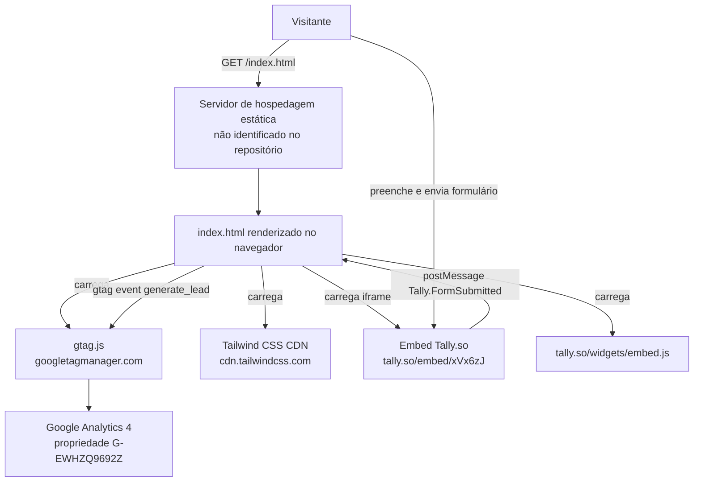

# Arquitetura atual

## Visão geral

O sistema é um único documento HTML estático, sem processo de servidor próprio, que delega toda a interatividade de negócio (captura de formulário) e toda a telemetria (analytics) a dois serviços de terceiros carregados via `<script>`/`<iframe>` diretamente no navegador do visitante.

### Evidências
- Arquivo: `index.html`
- Símbolo: `<script async src="https://www.googletagmanager.com/gtag/js?id=G-EWHZQ9692Z">` (linhas 13–16); `<script src="https://cdn.tailwindcss.com">` (linha 26); `<iframe data-tally-src="https://tally.so/embed/xVx6zJ...">` (linhas 102–111, 376–385); `<script src="https://tally.so/widgets/embed.js">` carregado dinamicamente (linhas 412–432); `window.addEventListener("message", ...)` (linhas 436–457)
- Responsabilidade observada: cada um desses pontos é carregado diretamente pelo navegador, sem passar por nenhum backend deste repositório.

## Camadas

Não há separação em camadas de aplicação (frontend/backend/dados) dentro deste repositório — existe apenas a camada de apresentação (HTML + CSS utilitário via CDN) e integrações client-side com serviços de terceiros.

## Hospedagem / infraestrutura

Não foi possível confirmar esta informação apenas pelas evidências disponíveis. O repositório não contém nenhum arquivo de configuração de hospedagem (`vercel.json`, `netlify.toml`, `Dockerfile`, workflow de CI/CD). O remote Git aponta para `https://github.com/Davidsouza20/zoui.git`, o que é compatível com, mas não comprova, hospedagem via GitHub Pages ou integração de um provedor estático com o GitHub. Ver [`../09-operacao/deploy-e-rollback.md`](../09-operacao/deploy-e-rollback.md).

## Segurança e fronteiras

- Não há autenticação, autorização ou sessão de usuário no sistema — a página é pública e sem login.
- O listener de `message` valida a origem do evento (`event.origin !== "https://tally.so"`) antes de processar o payload (`index.html`, linha 437), o que é uma prática correta de segurança para `postMessage`.

### Evidências
- Arquivo: `index.html`
- Símbolo: `if (event.origin !== "https://tally.so") return;` (linha 437)
- Responsabilidade observada: restringe o processamento de mensagens apenas às originadas do domínio oficial do Tally, mitigando `postMessage` spoofing de outras origens.
