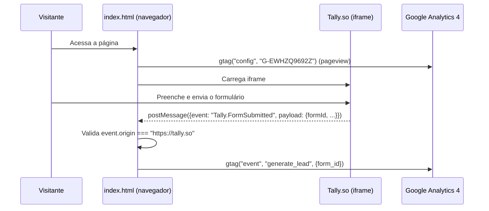

# Fluxo: captura de lead

Único fluxo de negócio identificável no repositório: um visitante se inscreve para o "acesso antecipado" do Zoui.

### Passo a passo com evidências

1. **Acesso à página**: o navegador carrega `index.html` e, no `<head>`, inicia o GA4 (`gtag("js", new Date())`, `gtag("config", "G-EWHZQ9692Z")`, linhas 22–23), registrando o pageview padrão do GA4.
2. **Renderização do formulário**: os blocos `#cta-hero` (linha 99, seção hero) e `#cta-final` (linha 373, seção de fechamento) contêm `<iframe data-tally-src="https://tally.so/embed/xVx6zJ?...">`. O script no final do `<body>` (linhas 412–432) injeta `src` nesses iframes chamando `Tally.loadEmbeds()` (ou fallback manual), fazendo o formulário do Tally efetivamente carregar.
3. **Preenchimento e envio**: a interação de preenchimento ocorre inteiramente dentro do iframe do Tally — não há código neste repositório que valide ou processe os dados do formulário.
4. **Notificação de envio**: ao submeter o formulário, o Tally envia uma mensagem via `window.postMessage` para a janela pai. O listener em `index.html` (linhas 436–457) verifica `event.origin === "https://tally.so"`, faz `JSON.parse` se o payload vier como string, e checa `payload.event === "Tally.FormSubmitted"`.
5. **Registro de conversão**: se as condições acima forem satisfeitas, dispara `gtag("event", "generate_lead", { form_id: payload.payload.formId })` (linhas 453–455), registrando o lead como conversão no GA4.

### O que acontece com o dado do lead após o envio

Não foi possível confirmar esta informação apenas pelas evidências disponíveis. O repositório não contém nenhuma integração de backend, webhook de saída (ex.: envio para CRM, planilha, e-mail) nem configuração do formulário Tally em si — essas configurações, se existirem, vivem inteiramente na conta do Tally.so, fora deste repositório. Ver pergunta de validação em [`../11-pendencias-de-entendimento/perguntas-para-validacao-humana.md`](../11-pendencias-de-entendimento/perguntas-para-validacao-humana.md).
